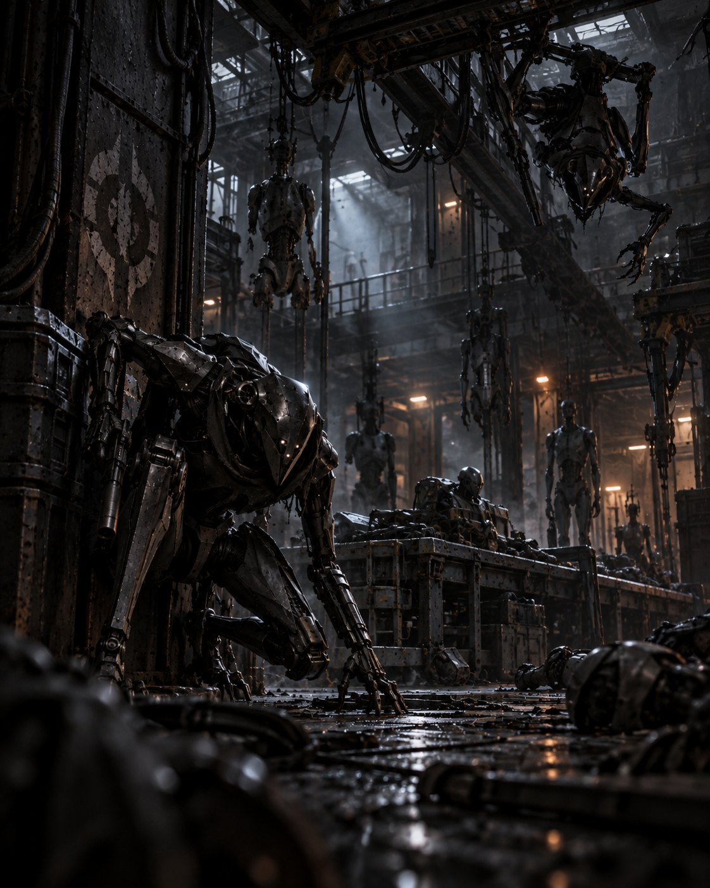

A pair of lurker droids: ad hoc constructions assembled from parts on the floor of the [[droid-factory|droid factory]] on [[brentaal-iv]]. Their names are graffitied on their chassis. One scuttled on all fours with shock claws; the other hid in the rafters with a suppressed light blaster.

## Session 2

They ambushed the crew in the dark. Hush charged [[kryss-dorn]] across the factory floor and caught him with its shock claws before he stunned it point-blank, its claw still reaching for his throat. Whisper dropped from the rafters and was pinned by [[tivik-ordo]]'s pistol fire. Kryss then hit an electrical panel beside it, overloading it and blowing it apart.

Hush survived long enough to be interrogated. Tivik sliced into it and got three answers before it shut down for good: [[feeler]] built them both; Feeler goes by many handles; and Feeler had stepped away to attend a function.
