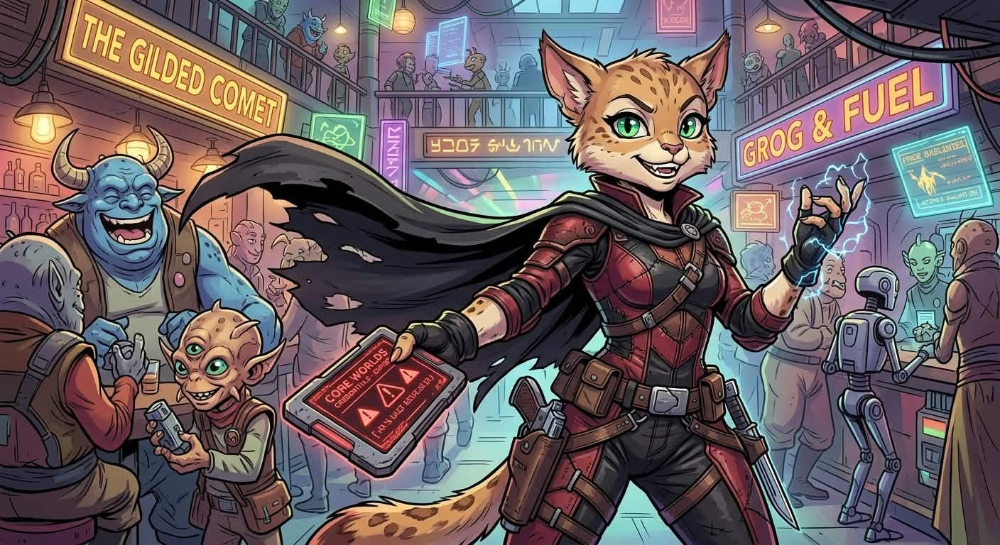

A Bothan doctor and social operator: persuasive first, surgeon second. Nira has real medical training and forged Core Worlds credentials that have since expired, and prefers to leave a room sedated rather than dead when a talked-in job goes wrong.

## Kit

A surgical vibroscalpel, shock gloves and a holdout blaster, all small enough to handle with precision rather than strength. A medpac, five stimpacks and a concealed field surgical kit. Armoured clothing and a comlink. A Bothan's convincing demeanour smooths over the rough edges of a lie.

## History

- Banned from practising medicine in the Core Worlds. Word of what happened is spreading.
- The forged medical credentials are expired — a complication waiting for the right scene.
- When she had nothing — no home, no work, no credits — [[tivik-ordo]] gave her a job and a place to stay. (Hook from Session 2.)
- Knows everyone's medical history, including that of Axel, leader of [[vega-squad]], and his not-so-faithful wife.

**Obligation:** Shame.

## Session 1

Sold [[armand]] a medical-extraction cover story, prepared the liquor that sedated [[imperial-moff|the Moff]], and tried to evacuate him under the same pretence. When [[lieutenant-voight]] refused, Nira fought with a vibroscalpel and left Armand incapacitated and bleeding. Nira also took blaster fire, then told [[axel]] to use Site B as the crew departed without Vega.

## Session 2

Spent the trip home in the medical bay with an organ cooler full of ice cream. In the debrief, she invoked doctor–patient privilege over [[vega-squad]], described the Moff's skull fracture and induced coma as proactive, and absorbed a thrown datapad from [[kel-oramm|Major Oramm]]. The ice cream did not survive.

On [[brentaal-iv]], she asked around for [[feeler]] with a napkin note and covered it with a loud joke about strippers. Outside the bar, she batted a carbine aside at point-blank range. In the [[droid-factory|droid factory]], she was caught under a ceiling net and cut her way out. She then took a blaster hit from a lurker droid and fought back with shock gloves and a salvaged droid leg used as an electrified bat. Afterwards she treated Kryss.

**Carrying:** a salvaged droid leg — a prosthetic for Kryss, should one be needed.

**Goal:** a long-term grudge against the establishment that drove her out of the Core Worlds.
