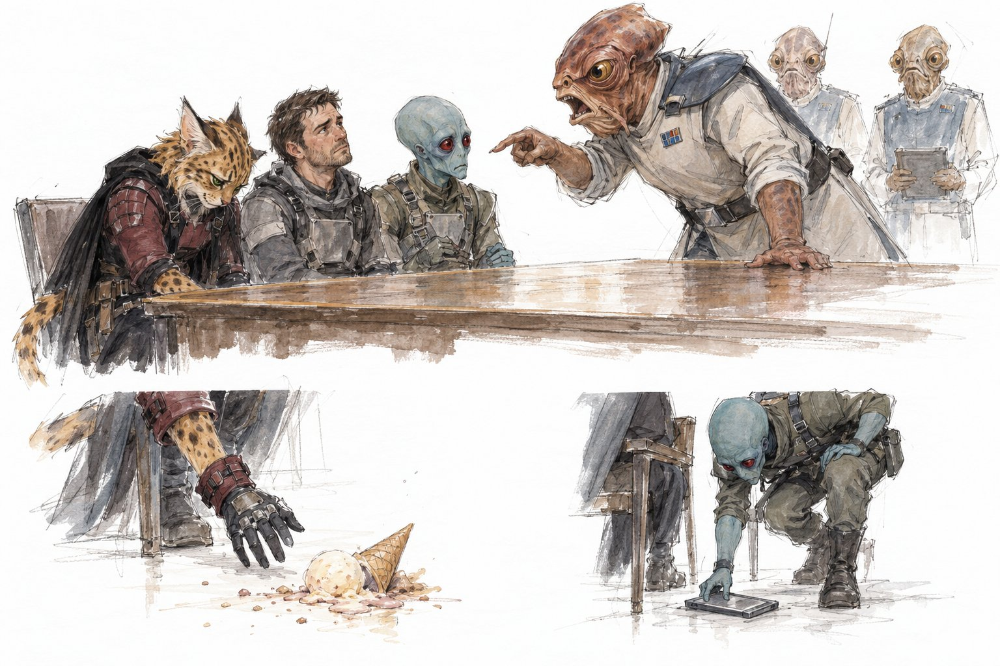
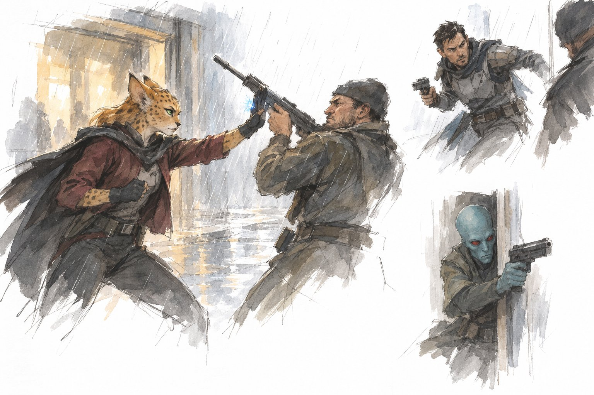
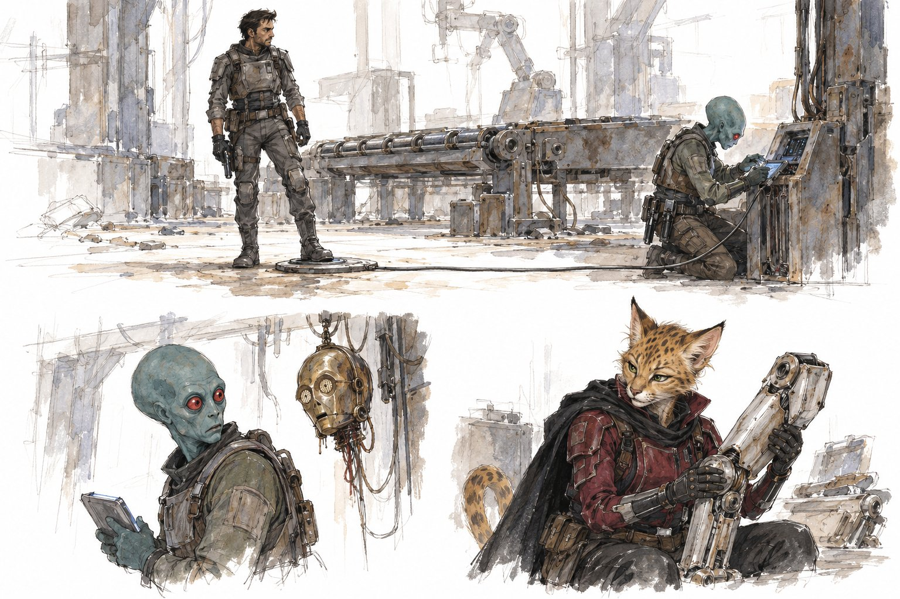
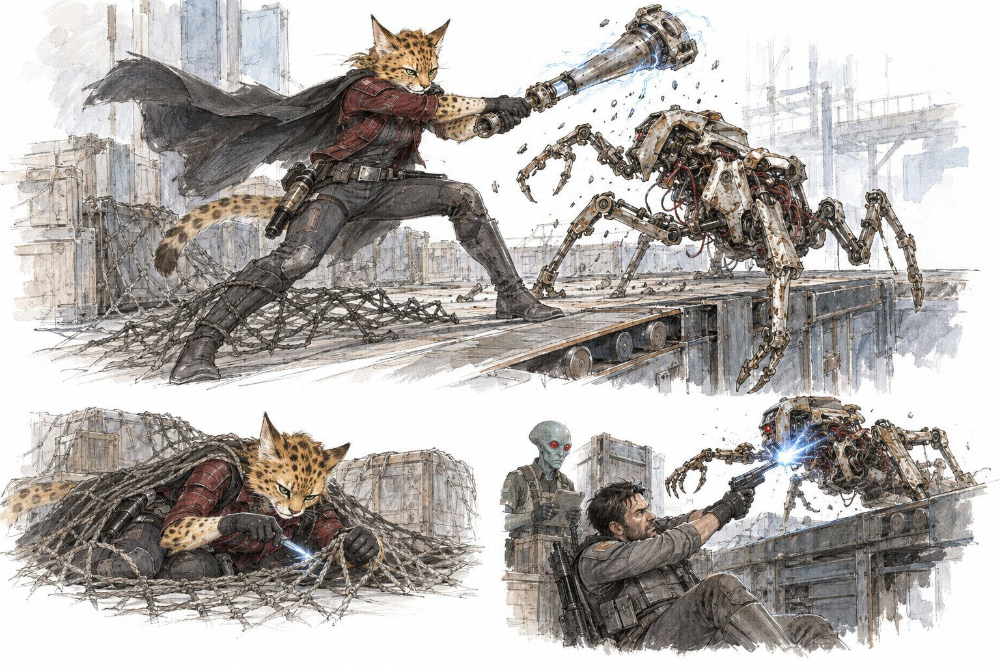
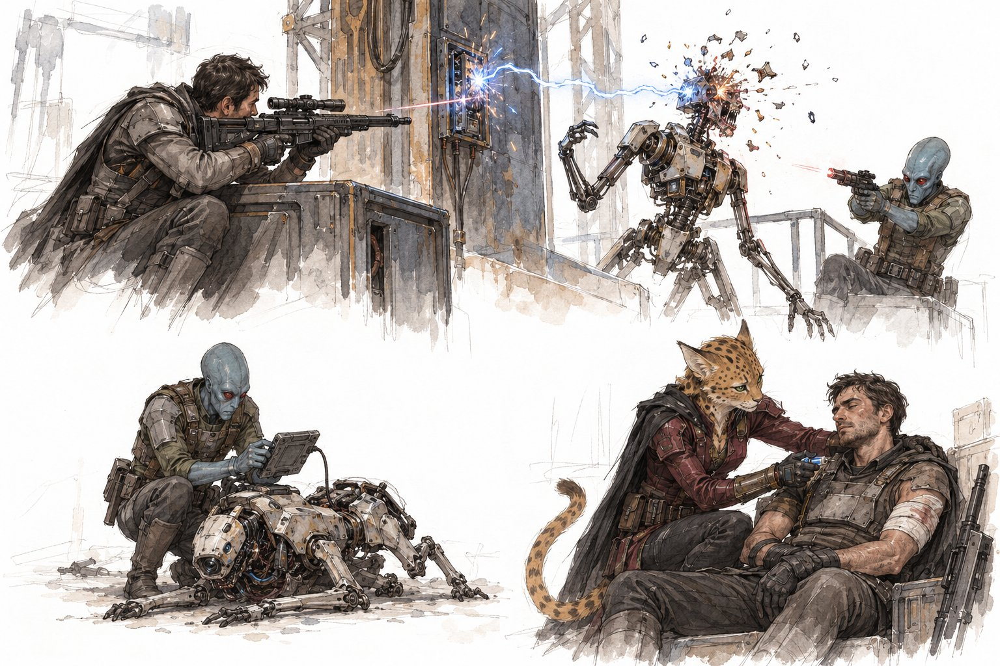

The crew came home with the Moff and without Vega. Their handler was not impressed. Docked pay, no repairs and one missing Ewok later, they were sent to find the slicer who got them onto the Moff's landing pad in the first place.

## The debrief

The [[mynocks-mullet]] jumped to a [[rebel-frigate|Mon Calamari frigate]] keeping station over an asteroid belt in the Mid Rim. While the others nursed their wounds, [[nira-dathwen]] found an organ-transport cooler in the medical bay and discovered it was full of ice cream.

After a long wait at a Kashyyyk-wood briefing table, their semi-regular handler [[kel-oramm|Major Kel Oramm]] arrived with two attendants and asked how it went. [[kryss-dorn]] reported the Moff unconscious in the cargo hold and suggested that ship repairs be claimed on Rebel insurance. Oramm asked where [[vega-squad]] was.

Nira cited doctor–patient confidentiality, hinted darkly at [[axel]]'s medical history, and explained that Vega had been sent to B-Site — surely, she reasoned, the reason nobody had told the crew about B-Site was cell security rather than any doubts about their competence. A vein began to pulse on Oramm's forehead. A cleaning droid outside heard the result and fled. Oramm threw a datapad at Nira, who dropped her ice cream, and berated the crew for half an hour: this was not the first time, Vega was the linchpin of many operations, and the crew had been sent to babysit.

When he asked after [[imperial-moff|the Moff]], Nira explained that she had improvised a strong narcotic and that he'd had "a bit of a fall". An attendant reported a fractured skull. Nira described the resulting induced coma as proactive.

While Oramm raged, [[tivik-ordo]] quietly scooped the thrown datapad off the floor. It turned out to be a sensitive intelligence briefing. Oramm announced that the whole affair would come out of their pay and that there was "Buckley's chance" of the ship being repaired at the Rebellion's expense.

## A new job

One of the attendants came back alone, kinder than her superior. Vega Company would surface, she said, but the crew should stop making a habit of leaving them in the lurch. Meanwhile Rebel Intelligence had questions of its own. The contact who arranged the crew's clearance to land at the Moff's pad — supplying the intelligence, the forged credentials and the landing information — had gone silent, and Intelligence was suspicious about how that landing had come about.

The new mission: go to [[brentaal-iv]] and bring in a slicer known as [[feeler]]. Intelligence had traced Feeler's last data packet to an installation there.

## Patching up

The trip to the frigate and back allowed everyone to recover from their wounds. Nira, practising medicine in a proper medical bay again, tried to treat Kryss's critical injury but ran out of time. The injury remains on his record, though its effects are gone.

At the quartermaster's cage, Tivik tried to replenish his explosives. The quartermaster pointed out that Vega would have burned through that much in minutes of practice and named a price of 500 credits. Tivik offered 400. Kryss slammed his pistol on the counter. The quartermaster pushed over a sealed, ready-packed case of grenades and charges, said "200 credits, and get out of here", and took Tivik's IOU.

Oramm's moratorium held. The [[mynocks-mullet]] left the frigate unrepaired, and without [[voshkar]]. Shortly before departure, the Ewok was pulled aside for random drug and alcohol testing. The crew waited for hours. The Rebels said only that he was "indisposed".

## Brentaal IV

[[brentaal-iv]] is a dense, rainy city world. It is no Coruscant, but buildings crowd every horizon, Imperials are active, and an underworld thrives beneath them. Rebel Intelligence's trace led to [[droid-factory|a decrepit warehouse]] behind fences and open ground. Across the street, a municipal crew was digging up the sewers by night.

The crew went to find information first. A third-shift bar was full of hi-vis workers. Kryss flicked 100 credits over the bar for three drinks and told the bartender to keep the change. Nira wrote "we are looking for a person called the Feeler" on a napkin. The bartender asked whether it was a stripper's name, then explained that a crew had recently been paid big credits to install data cabling in the warehouse across the street, even though it hadn't operated for a couple of cycles. Nira thanked him loudly for directions to the strippers. Kryss led the bar in a drinking song, to Tivik's visible embarrassment.

Tivik reminded the others to use his mission codename, Jaxon Kel; the slicer community is small.

## Outside the bar

The flashy credstick had attracted attention. Two thugs with death sticks and carbines blocked the way and suggested that the lady hand over her credits. Nira couldn't read their allegiances in the rain, but was fairly sure they were lying about having backup. Kryss offered to buy them a drink instead. It didn't work.

One thug jammed his carbine against Nira's chest and fired. She batted the barrel aside, and her shock gloves crackled to life. Her vibroscalpel missed, but the thug fell backwards trying to avoid it, and she kicked over a barrel for cover. Kryss quick-drew his pistol and riddled the second thug with autofire, then sidestepped his return fire. Tivik moved to the doorway's flank and hit the first thug with a heavy pistol shot. Neither thug had landed a blow; both ran off into the rain.

Kryss winged one with a parting rifle shot. The thug dropped a grimy satchel containing a packet of death sticks, 50 credits and a small bag of unidentified white powder.

## The droid factory

Kryss's survey of the warehouse found no cameras, patrols or turrets — just dilapidation and newly installed infrastructure. The crew slipped in behind a sheet of plywood. Inside lay a long-dead droid production line: a tangle of conveyors, dangling armatures, and half-built protocol droids with creepy faces slumped everywhere.

Kryss stepped on a newly installed pressure plate wired into the building's power. He froze, called for Jaxon and stayed calm enough to expose the wiring back to a control terminal. Tivik sliced it and disarmed the trap without using his demolitions kit. Turning around, he came face to face with a dead droid's dangling head. Nira salvaged a good droid leg, in case Kryss ever needs a prosthetic.

A gantry led to offices on the upper floor. On the way, Nira triggered a ceiling net made from repurposed cargo mesh, which slammed her to the ground. She began cutting her way out with her vibroscalpel. Tivik noticed a shadow moving. Kryss charged after it, swung at what turned out to be an inert droid, and realised that there were two threats: one on the floor and one up high.

## Hush and Whisper

The crew had been ambushed by two lurker droids, cobbled together from the factory's spare parts. The first scuttled across the floor on all fours towards Kryss. He dived behind a conveyor. Nira, free of the net, hit it with her shock gloves. The second dropped onto the gantry and shot Nira with a suppressed blaster. The first leapt the conveyor and caught Kryss with shock claws, tearing itself up on the machinery in the process.

Nira took up the salvaged droid leg and swung it like an electrified bat. Tivik threw a frag grenade at the gantry droid, leaving the gantry hanging askew. Kryss put a point-blank stun bolt into the clawed droid, Hush, freezing it mid-lunge with its claw reaching for his throat. The gantry droid dropped to the floor and tried to vanish into the dark, but Tivik pinned it with pistol fire. Kryss switched to his rifle, aimed for a headshot and missed, but hit an electrical panel instead. The arc of current overloaded the droid's head, and Whisper exploded.

Both droids had their names daubed on their chassis. [[hush-and-whisper|Hush]] survived just long enough for Tivik to slice into it and get three answers before it shut down. Hush and Whisper were built by Feeler. Their master goes by many handles, Feeler being the most common, and had stepped away to attend a function.

Nira used her medpac on Kryss, stimmed him, and put a lit death stick in his mouth for the pain.

## Where things stand

- The warehouse holds enough intelligence to identify Feeler's next move: a function somewhere on Brentaal IV.
- Voshkar is "indisposed" somewhere on the Rebel frigate, having an adventure of his own.
- Tivik has Oramm's sensitive briefing datapad. Its contents haven't been revealed.
- The ship remains unrepaired, and the crew's pay is docked.
- Tivik owes the quartermaster 200 credits for a case of grenades and charges.
- Tivik's obligation came up at the end of Session 1 and has not yet bitten. The GM has carried it into Session 3.

> [!note] Source and uncertain details
> Based on the Session 2 recording transcript. The spelling of Feeler needs confirmation.
